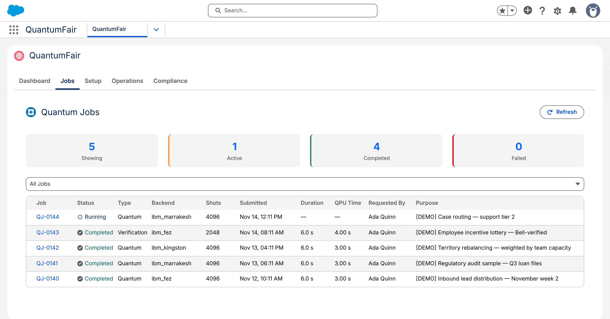
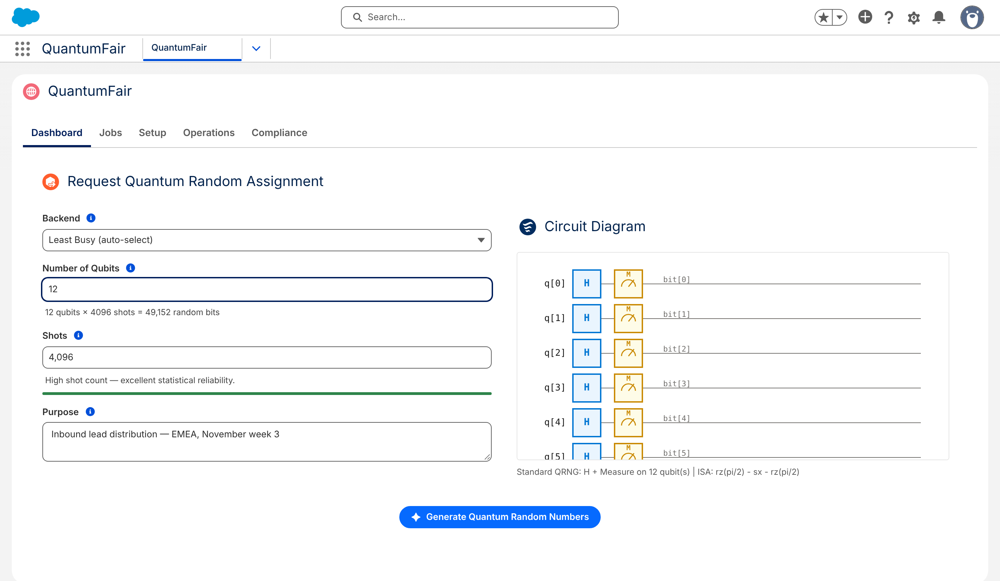
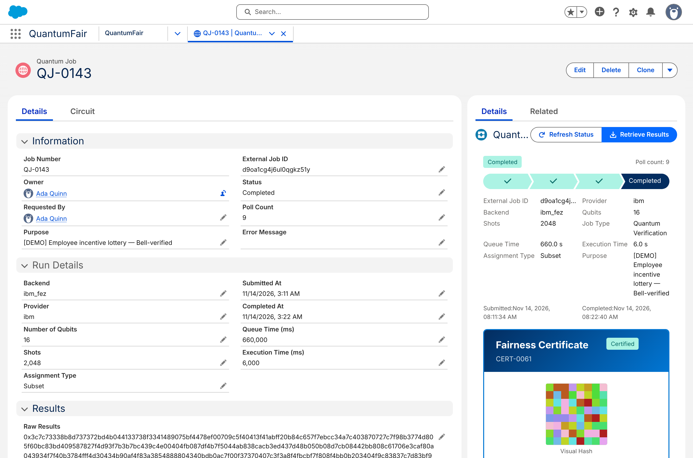
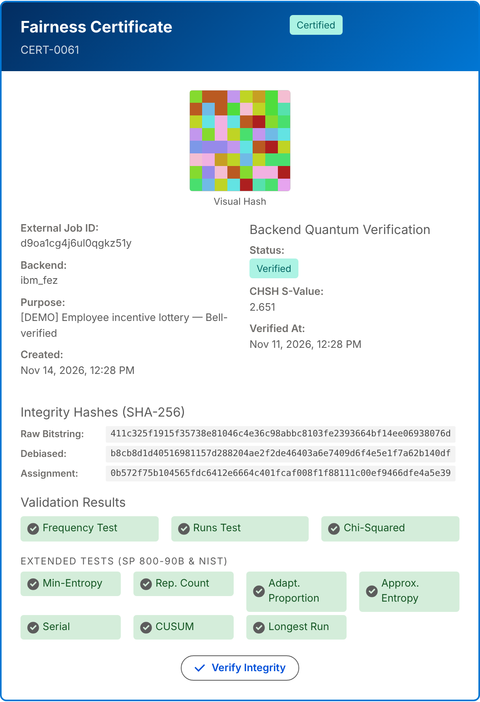
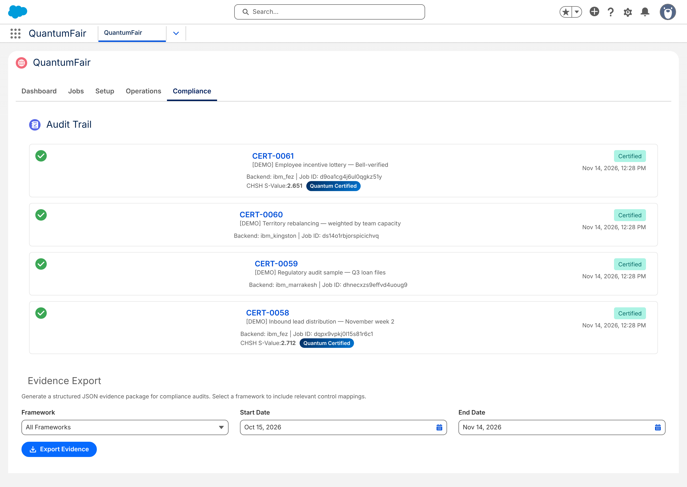

# QuantumFair (open-qrng)

**Quantum circuits from Salesforce to IBM Quantum hardware — with no middleware.**

An [Open Systems Foundation Labs](https://opensf.foundation/products/quantumfair/) tech demo · Apache-2.0



---

QuantumFair shows that a Salesforce org can build quantum circuits in Apex and submit them straight to the IBM Quantum REST API. There is no Python service, no Qiskit and no Heroku or AWS layer in between: Apex builds the circuit, sends it, polls for the result and processes the measurements, all on the platform.

The use case it demonstrates is **certified fair randomness**: random assignment and selection (lead routing, audit sampling, panel selection, trial randomization) driven by bits measured on a quantum processor, with a tamper-evident certificate behind every decision.

## What this is — and is not

- **A concept and reference implementation.** It runs on real IBM Quantum hardware with your own IBM account (BYOQ). It is not a supported commercial product.
- **Not cost-competitive today.** IBM's free Open Plan includes 10 minutes of QPU time per rolling window — enough for many evaluation jobs, since a standard job uses a few seconds. Pay-as-you-go is billed per second (USD 96/minute at the time of writing). A classical CSPRNG is effectively free.
- **Honest about its claims.** Assignments are replayable and certificates are tamper-evident. The optional Bell test gives evidence _consistent with quantum origin_ (CHSH violated by at least 2σ). It is not device-independent certified randomness: you still trust IBM to run the circuit on the hardware it reports.

## How it works

1. **Request** — a Flow, Apex or the app asks for a random assignment ("assign these 50 leads across 5 reps"). The Flow action is bulk-safe: it only queues `Pending` jobs.
2. **Build** — Apex generates ISA-compliant OpenQASM 3.0 in IBM Heron native gates (`rz`, `sx`, `x`, `cz`).
3. **Submit** — a Queueable authenticates with IBM IAM and posts a Sampler job to `quantum.cloud.ibm.com`.
4. **Poll** — a Queueable/Schedulable chain polls with backoff (6-hour budget); transient IBM errors are retried.
5. **Certify** — per-qubit von Neumann debiasing, then frequency, runs and chi-squared tests at alpha = 0.01. Certificates are SHA-256 hash-chained; NIST SP 800-90B health tests run afterwards and can revoke a certificate.
6. **Assign** — rejection sampling turns bits into assignments (never modulo, never a pseudo-random fallback). The same bits always produce the same result, and the assignment hash is stamped on the certificate.
7. **Notify** — Platform Events update the UI in real time and let Flows apply the results.

## Screenshots

| Request                                     | Job detail                                |
| ------------------------------------------- | ----------------------------------------- |
|     |  |
| **Fairness certificate**                    | **Compliance**                            |
|  |  |

_Screenshots: a scratch org with demo data from `scripts/seed-demo-data.sh` (mocked IBM responses)._

## Install

**Unlocked package (v1.0, no namespace)** — log in as an admin and open:

- Production or Developer Edition: <https://login.salesforce.com/packaging/installPackage.apexp?p0=04tTt0000001QWjIAM>
- Sandbox: <https://test.salesforce.com/packaging/installPackage.apexp?p0=04tTt0000001QWjIAM>

Choose **Install for Admins Only**. Release notes are on the [v1.0.0 release](https://github.com/OpenSystemsFoundation/open-qrng/releases/tag/v1.0.0).

**From source:**

```bash
git clone https://github.com/OpenSystemsFoundation/open-qrng.git
cd open-qrng
sf project deploy start --target-org <your-org>
sf org assign permset --name QuantumFair_Admin --target-org <your-org>
```

Requires Salesforce Enterprise, Unlimited or Developer Edition and an [IBM Quantum Platform](https://quantum.cloud.ibm.com) account.

## Quick setup

1. Assign **QuantumFair_Admin** to yourself (the System Administrator profile alone cannot change settings).
2. Open the **QuantumFair** app (`/lightning/n/QuantumFair`) → **Setup** tab.
3. Paste your IBM Quantum API key, enter or auto-detect your instance CRN, and click **Test Connection**.
4. Go to **Dashboard**, enter a purpose and click **Generate Quantum Random Numbers**.
5. Give `QuantumFair_User` to people who request assignments and `QuantumFair_Auditor` to auditors.

The full walkthrough — Flow templates, certificates, verification, compliance export and troubleshooting — is in the [Manual](docs/manual.md).

## Security model

- The IBM API key lives in a hierarchy custom setting that only admins can read (View All Custom Settings / Customize Application), is never returned to the browser and never logged; only a short-lived bearer token is cached (Platform Cache). The key is plaintext at rest — add Shield Platform Encryption or your own Named Credential if your policy requires encryption.
- Privileged actions require the **`QuantumFair_Administer`** custom permission (in `QuantumFair_Admin` only).
- All objects are **Private**; CRUD/FLS is enforced server-side; auditors never receive raw bitstrings.
- No Salesforce data leaves the org — only circuit definitions are sent to IBM.

See [SECURITY.md](SECURITY.md) to report a vulnerability.

## Documentation

- [Solution Design](docs/solution-design.md) — architecture, IBM integration, randomness math, data model, security, limits, extensibility
- [Manual](docs/manual.md) — installation, configuration, usage, Flow integration, verification, troubleshooting

## Development

```bash
npm install
npm run test:unit         # 446 LWC Jest tests
npm run test:e2e          # 147 Playwright tests (mock fixture, no org needed)
npm run lint              # ESLint
npm run prettier:verify   # Formatting check

# Apex (~490 test methods in 30 test classes) against a scratch org
sf org create scratch -f config/project-scratch-def.json -a qrng-dev
sf project deploy start --target-org qrng-dev
sf apex run test --target-org qrng-dev --code-coverage --result-format human --wait 10
```

### Explore without an IBM account

`scripts/seed-demo-data.sh` fills a scratch org with demo jobs, certificates and assignments. It mocks the IBM API by feeding locally generated Sampler results through the real processing pipeline (debiasing, validation, certificate chain, assignment engine), so every screen has data. The bits are not quantum and every record is labelled `[DEMO]` — use it for demos and UI work only.

```bash
scripts/seed-demo-data.sh qrng-dev
```

| Layer    | Technology                            |
| -------- | ------------------------------------- |
| Backend  | Apex (API v66.0)                      |
| Frontend | Lightning Web Components, Canvas 2D   |
| Quantum  | IBM Quantum Platform REST API (Heron) |
| Testing  | Apex tests, sfdx-lwc-jest, Playwright |
| CI       | GitHub Actions + Salesforce CLI       |

See [CONTRIBUTING.md](CONTRIBUTING.md) to contribute.

## License

Apache-2.0 — see [LICENSE](LICENSE) and [NOTICE](NOTICE).
