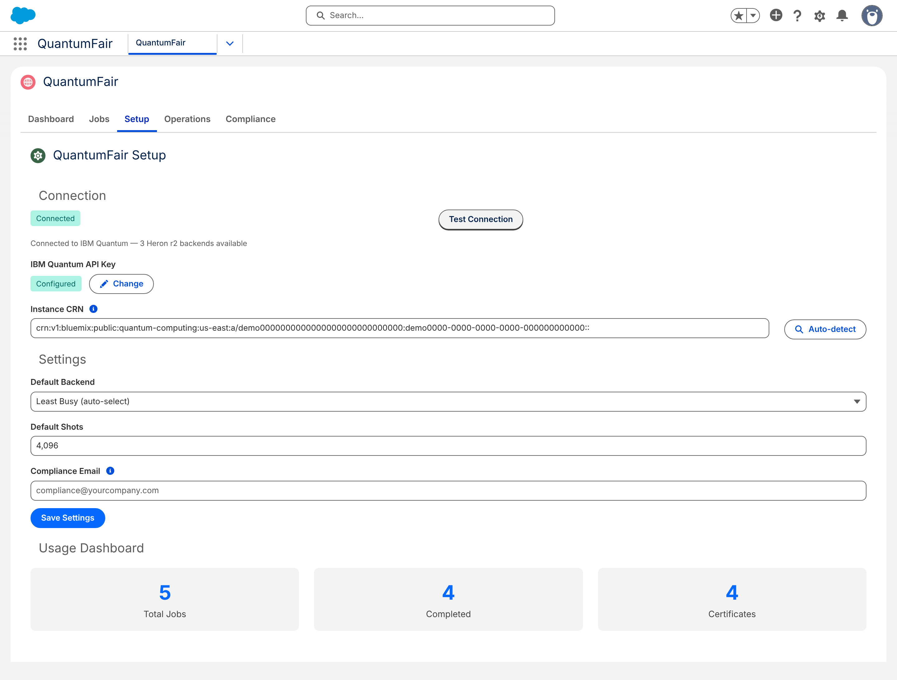
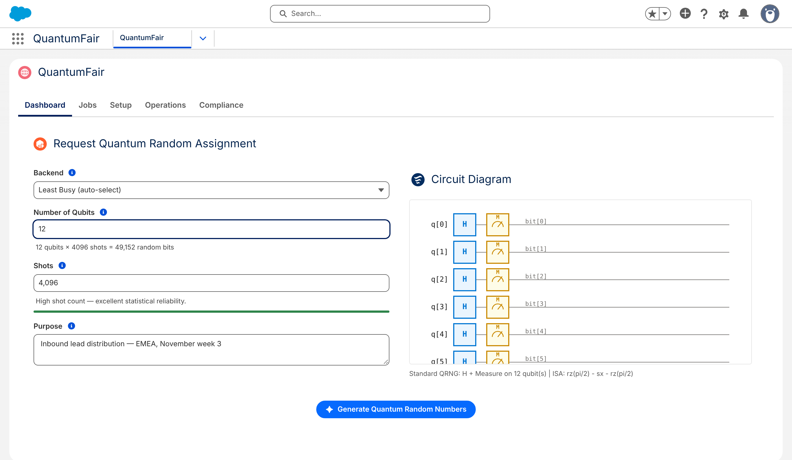
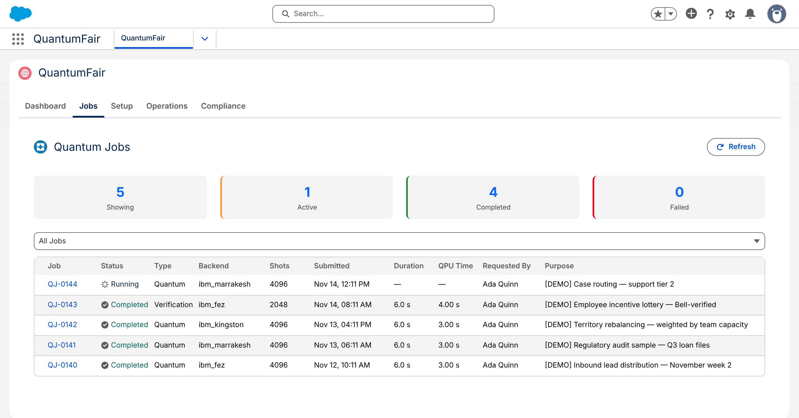
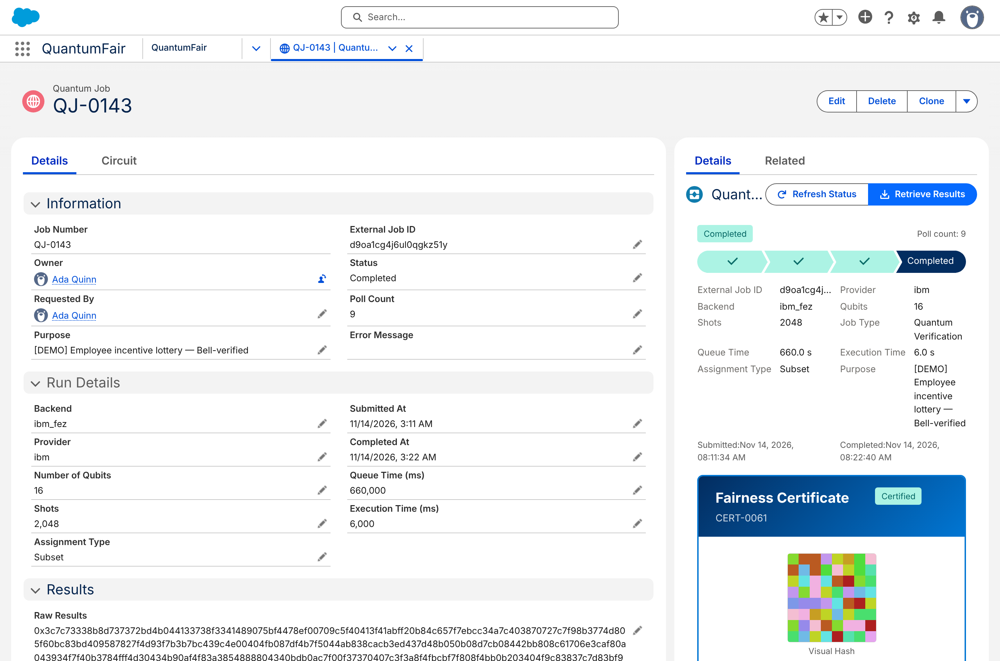
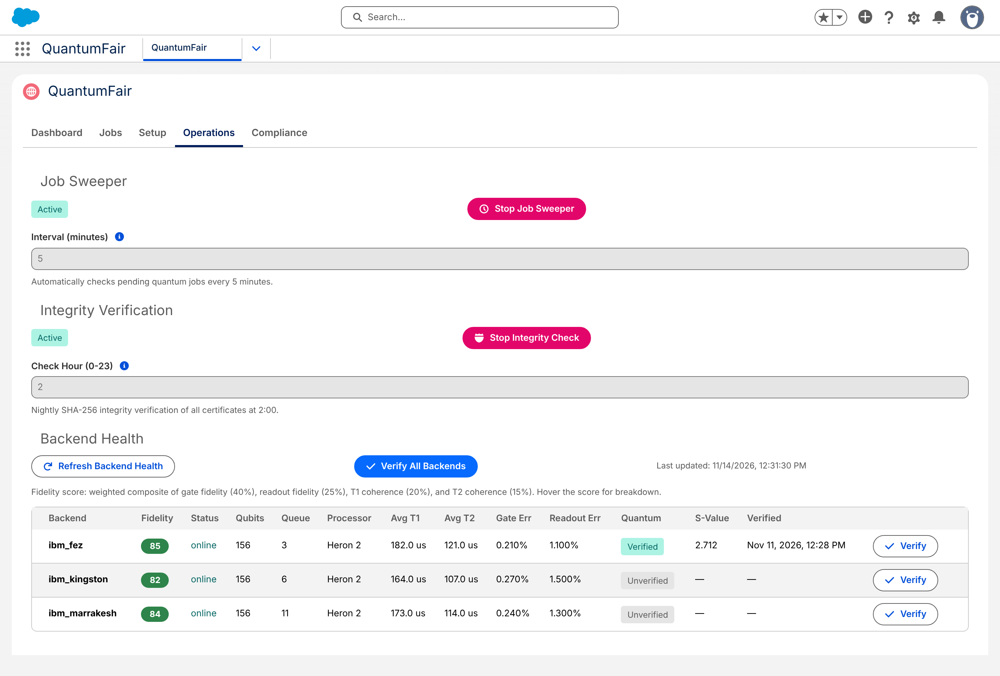
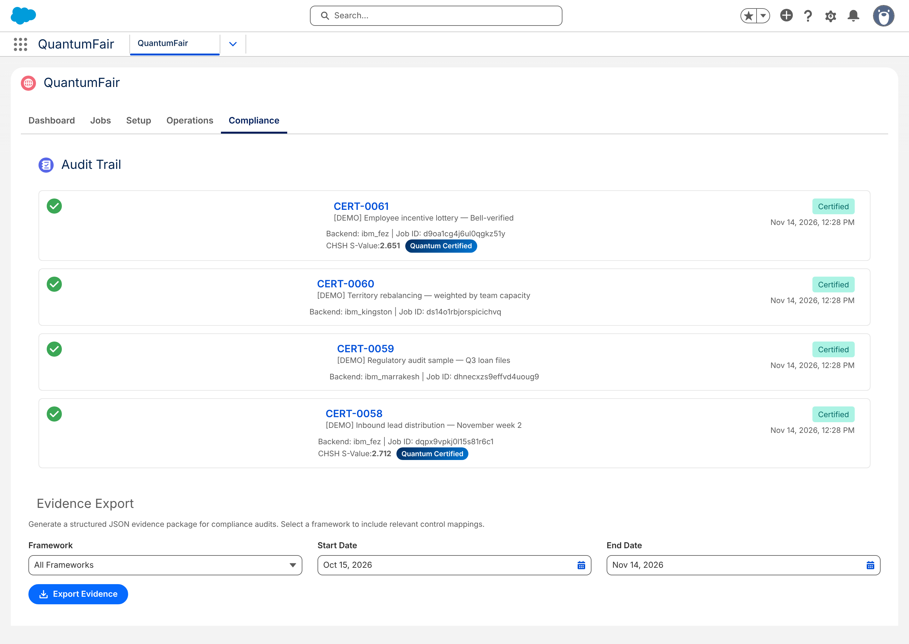
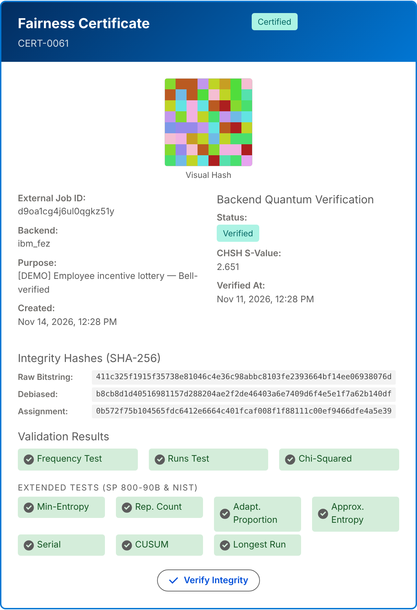

# QuantumFair — Manual

Installation, configuration and day-to-day use of QuantumFair for Salesforce admins, business users and auditors. For the technical design, see the [Solution Design](solution-design.md).

> QuantumFair is an Open Systems Foundation **Labs** tech demo. It runs on real IBM Quantum hardware with your own IBM account. Treat it as a reference implementation, not a supported product.

## Contents

1. [Requirements](#1-requirements)
2. [Installation](#2-installation)
3. [IBM Quantum account setup](#3-ibm-quantum-account-setup)
4. [Configuring QuantumFair](#4-configuring-quantumfair)
5. [Permission sets and personas](#5-permission-sets-and-personas)
6. [Using the app](#6-using-the-app)
7. [Running assignments from Flow](#7-running-assignments-from-flow)
8. [Certificates, verification and replay](#8-certificates-verification-and-replay)
9. [Compliance evidence](#9-compliance-evidence)
10. [Operations and background jobs](#10-operations-and-background-jobs)
11. [Example use cases](#11-example-use-cases)
12. [Troubleshooting](#12-troubleshooting)

---

## 1. Requirements

- Salesforce **Enterprise, Unlimited or Developer** Edition (Lightning Experience)
- An **IBM Quantum Platform** account with an API key and a Quantum instance (the free Open Plan works for evaluation)
- For source deploys: [Salesforce CLI](https://developer.salesforce.com/tools/salesforcecli) (`sf`)

**Cost.** The Open Plan includes 10 minutes of QPU time per rolling window. A standard QRNG job uses a few seconds, so the free allowance covers many evaluation jobs. Beyond that, IBM bills pay-as-you-go per second (USD 96/minute at the time of writing). Check your usage on the IBM Quantum Platform dashboard.

---

## 2. Installation

### Option A — Unlocked package (v1.0)

1. Open the install link while logged in as an admin:
   `https://login.salesforce.com/packaging/installPackage.apexp?p0=04tXXXXXXXXXXXXXXX`
   (use `https://test.salesforce.com/...` for sandboxes). The current link is also listed on the [GitHub Releases](https://github.com/OpenSystemsFoundation/open-qrng/releases) page.
2. Choose **Install for Admins Only** (you will grant access with permission sets).
3. Approve access to the three IBM hosts when prompted (the Remote Site Settings ship with the package).

QuantumFair is an **unlocked package with no namespace**: all metadata stays editable in your org, and later versions install over this one as upgrades. Released versions install in production and sandboxes.

### Option B — Source deploy

```bash
git clone https://github.com/OpenSystemsFoundation/open-qrng.git
cd open-qrng
sf org login web --alias my-org
sf project deploy start --target-org my-org
sf org assign permset --name QuantumFair_Admin --target-org my-org
```

### After installing

1. Assign **QuantumFair_Admin** to yourself (required — the System Administrator profile alone cannot change settings).
2. Open the App Launcher, search **QuantumFair**, and open the app (`/lightning/n/QuantumFair`).

---

## 3. IBM Quantum account setup

1. Sign in or create an account at [quantum.cloud.ibm.com](https://quantum.cloud.ibm.com).
2. **Create an instance** if you do not have one (choose the Open Plan for free evaluation). Note the instance **CRN** — it starts with `crn:v1:bluemix:public:quantum-computing:`.
3. **Create an API key** from the IBM Quantum Platform dashboard (or IBM Cloud → Manage → Access (IAM) → API keys). Copy it — IBM shows it only once.

Keep the key out of email, chat and source control. You will paste it into QuantumFair once; it is never shown again in Salesforce.

---

## 4. Configuring QuantumFair

Open the **Setup** tab of the QuantumFair app.



### Connection

1. Paste the key into **IBM Quantum API Key** and click **Save Key**.
2. Enter the **Instance CRN**, or click **Auto-detect** to look it up from your IBM account.
3. Click **Test Connection**. The badge turns **Connected** and the backend list populates.

Saving a working key automatically schedules the **Job Sweeper** and the nightly **Integrity Verification** job.

### Settings

| Setting              | Purpose                                                                    |
| -------------------- | -------------------------------------------------------------------------- |
| **Default Backend**  | QPU used when a request does not name one (e.g. `ibm_kingston`)            |
| **Default Shots**    | Shots per circuit (default 1024; use 4096+ for Bell-test jobs)             |
| **Compliance Email** | Recipient of the daily hash digest; saving it schedules the digest (06:00) |

Clearing the compliance email unschedules the digest. Every settings change is logged as a `SETTINGS_CHANGED` compliance event (field names only, never values).

---

## 5. Permission sets and personas

| Permission set        | Give to                        | What they can do                                                                 |
| --------------------- | ------------------------------ | -------------------------------------------------------------------------------- |
| `QuantumFair_Admin`   | Admins who configure the app   | Everything: settings, scheduled jobs, backend verification, evidence export      |
| `QuantumFair_User`    | People who request assignments | Submit requests; view jobs, certificates and results                             |
| `QuantumFair_Auditor` | Internal or external auditors  | Read-only access to jobs, certificates and evidence; raw bitstrings are withheld |

All QuantumFair objects are **Private** by default: users see their own jobs unless you add sharing rules.

---

## 6. Using the app

The app has five tabs.

### Dashboard — request randomness

1. In **Request Quantum Random Assignment**, describe the **Purpose** (it is printed on the certificate).
2. Optionally choose a **Backend**, **Number of Qubits** (default 8) and **Shots**.
3. Click **Generate Quantum Random Numbers**.



A **Job Monitor** card appears and moves through **Submitted → Queued → Running → Completed** in real time. IBM queue times range from seconds to hours depending on the backend; you can close the page and come back.

### Jobs — history and detail

The **Quantum Jobs** table lists every job you can see, with a status **Filter** and **Refresh**.



Open a job to see:

- the **circuit** that was sent (OpenQASM and a rendered diagram),
- measurement charts and the **validation results** (frequency, runs, chi-squared, and CHSH for Bell-test jobs),
- the linked **Fairness Certificate** and any **assignments**.



If a job ran out of polling budget but IBM finished it later, use **Retrieve Results** on the job.

### Setup

Connection and settings — see [section 4](#4-configuring-quantumfair).

### Operations

- **Backend Health** — queue length, error rates and verification status per backend. **Verify** runs a CHSH test on one backend; **Verify All Backends** runs it on all of them.
- **Job Sweeper** — the safety net that recovers stuck jobs; set its **Interval (minutes)**.
- **Integrity Verification** — the nightly re-hash of all certificates; set the **Check Hour (0-23)**.



### Compliance

- **Audit Trail** — timeline of jobs, certificates and compliance events.
- **Evidence Export** — see [section 9](#9-compliance-evidence).



---

## 7. Running assignments from Flow

The **Quantum Random Assignment** action (category **QuantumFair**) assigns or selects records using a certified random pool.

### Inputs and outputs

| Input            | Description                                                  |
| ---------------- | ------------------------------------------------------------ |
| Record IDs       | Records to assign or select from                             |
| Assignee IDs     | Users/queues to assign to (not used for Subset)              |
| Assignment Type  | `Uniform`, `Weighted` or `Subset`                            |
| Weights          | One weight per assignee (Weighted only)                      |
| Sample Size      | How many records to pick (Subset only)                       |
| Purpose          | Printed on the certificate                                   |
| Use Bell Test    | Adds a CHSH test for evidence consistent with quantum origin |
| Number of Qubits | Optional (default 8)                                         |
| Backend          | Optional (default from settings)                             |

Outputs: **Job ID**, **Success**, **Error Message**.

| Problem                               | Example                       | Type       |
| ------------------------------------- | ----------------------------- | ---------- |
| Spread N records evenly over M people | 50 leads → 5 reps             | `Uniform`  |
| Spread N records by capacity          | 50 leads → 5 reps by quota    | `Weighted` |
| Pick K records out of N               | 10 deals out of 500 for audit | `Subset`   |

The action is **asynchronous and bulk-safe**: it only creates `Pending` jobs and queues them, so it is safe in record-triggered (after-save) flows and with up to 200 interviews per transaction. Results arrive later.

### Shipped flow templates

Five templates ship in **Draft**. Open **Setup → Flows**, open the template, replace the placeholder IDs (queue/group IDs, thresholds), then save as a new version and activate.

| Template                           | Object      | Trigger            | Type                |
| ---------------------------------- | ----------- | ------------------ | ------------------- |
| Quantum Assign Leads               | Lead        | Record-triggered   | Uniform             |
| Quantum Route Cases                | Case        | Record-triggered   | Uniform             |
| Quantum Select Deals for Review    | Opportunity | Scheduled (weekly) | Subset              |
| Quantum Rebalance Accounts         | Account     | Screen flow        | Uniform or Weighted |
| Quantum Assign (Uniform) — generic | Any         | Screen flow        | All three           |

### Applying the results (companion flow)

Because the quantum job finishes later, pair your flow with a **Platform Event–triggered flow** on `Quantum_Job_Complete__e`:

1. **Trigger:** `Quantum_Job_Complete__e`.
2. **Get Records:** `Quantum_Assignment__c` where `Quantum_Job__c` = `{!$Record.Job_Id__c}`.
3. **Loop:** for each assignment, update the source record (`Assigned_Record_ID__c`) — for example set `OwnerId` to `Assigned_To_ID__c`, or create a review Task for Subset selections.
4. Optionally subscribe to `Quantum_Job_Failed__e` to alert an admin.

### From Apex

```apex
QuantumRandomAssignment.AssignmentRequest req = new QuantumRandomAssignment.AssignmentRequest();
req.recordIds = leadIds;          // List<String>
req.assigneeIds = repIds;         // List<String>
req.assignmentType = 'Uniform';
req.purpose = 'Weekly lead distribution';
List<QuantumRandomAssignment.AssignmentResult> res =
    QuantumRandomAssignment.execute(new List<QuantumRandomAssignment.AssignmentRequest>{ req });
Id jobId = res[0].jobId;
```

### Sizing

- 8 qubits × 1024 shots = 8,192 raw bits; after debiasing roughly 2,000 usable bits — enough for hundreds of draws.
- Each draw uses `ceil(log2(M))` bits plus occasional rejected blocks.
- Use 4096+ shots for large batches (100+ records) and for Bell-test jobs.
- If the pool runs out the job fails rather than falling back to pseudo-randomness — resubmit with more shots.

---

## 8. Certificates, verification and replay

Every successful job produces a **Fairness Certificate**.



| Status      | Meaning                                                   |
| ----------- | --------------------------------------------------------- |
| `Certified` | Bits passed validation; assignment hash stamped           |
| `Failed`    | Bits failed validation; no assignment was made            |
| `Revoked`   | Extended NIST SP 800-90B tests failed after certification |
| `Pending`   | Processing has not finished                               |

What an auditor can check:

1. **The job happened at IBM** — the certificate shows the IBM job ID, backend and exact circuit; the job can be looked up with IBM's API.
2. **The record was not altered** — click **Verify Integrity** to recompute the raw, debiased and assignment hashes. The nightly job does the same and sets **Tampered** on any mismatch. Certificates are hash-chained, so deleting or reordering one breaks the chain.
3. **The assignment follows from the bits** — replay the documented rejection-sampling rules (see the [Solution Design](solution-design.md#6-layer-4--assignment-engine)) on the debiased pool and compare the SHA-256 of the canonical serialization with `Assignment_Hash__c`. Each assignment also stores the exact bits consumed in `Random_Value__c`.

**About the Bell test.** A Bell-test certificate shows the CHSH S-value, its standard error and the margin. Certification requires S to exceed the classical bound of 2 by at least two standard errors. This is evidence _consistent with quantum origin_; it is not device-independent proof, and it still relies on IBM running the circuit as reported.

**Small pools.** Pools under roughly 2,500 bits fail the extended min-entropy check even when balanced, so they may be revoked. Use more shots for audit-grade certificates.

---

## 9. Compliance evidence

**Evidence Export** (Compliance tab, admins only) downloads a JSON evidence package for a date range and framework: **ISO 27001**, **SOC 2**, **NIST SP 800-90B**, **GDPR** or **eIDAS**. Controls are mapped by the 24 `Compliance_Control__mdt` records, which you can extend.

The **daily digest** (when a compliance email is set) emails the current certificate-chain head hash and a daily summary to an external mailbox, so later tampering inside the org can be detected against a record held outside it.

---

## 10. Operations and background jobs

| Job                    | Schedules when                 | Does                                                             |
| ---------------------- | ------------------------------ | ---------------------------------------------------------------- |
| Job Sweeper            | First successful settings save | Recovers stuck jobs, fails abandoned ones, processes completions |
| Integrity Verification | First successful settings save | Re-hashes certificates nightly, walks the chain                  |
| Compliance Digest      | Compliance email saved         | Daily 06:00 hash digest email                                    |
| Poll chain (per job)   | Each submission                | Polls IBM with backoff (1 min ×5, then 2, 3, 5, 7, max 10 min)   |

Jobs that are not finished within **6 hours** of submission are marked failed; the IBM job ID is kept so **Retrieve Results** can recover them. You can stop and start the sweeper and integrity job from the **Operations** tab, and see all of them under **Setup → Scheduled Jobs**.

---

## 11. Example use cases

All of these follow the same pattern: collect record IDs (and assignee IDs), call the action with the right type, apply the results in a companion flow, and keep the certificate as evidence.

| Domain             | Use case                                      | Type                    | Notes                                                   |
| ------------------ | --------------------------------------------- | ----------------------- | ------------------------------------------------------- |
| Sales              | Lead round-robin                              | Uniform                 | Template: Quantum Assign Leads                          |
| Sales              | Territory rebalancing                         | Uniform/Weighted        | Template: Quantum Rebalance Accounts                    |
| Sales              | Deal review selection                         | Subset                  | Template: Quantum Select Deals for Review               |
| Customer service   | Case routing / escalations                    | Uniform                 | Template: Quantum Route Cases                           |
| Customer service   | QA sample selection                           | Subset                  | Pick cases for quality review without cherry-picking    |
| Financial services | Audit and compliance spot checks              | Subset                  | Regulators expect unbiased sampling                     |
| Financial services | Loan review assignment                        | Uniform                 | Separates applicants from reviewer choice               |
| Healthcare         | Clinical trial randomization                  | Weighted                | Weights give the allocation ratio; enable the Bell test |
| Healthcare         | Patient–provider assignment, quality audits   | Uniform/Subset          | Custom or Health Cloud objects via the generic template |
| Human resources    | Interview panels, training slots              | Subset                  | Demonstrable non-bias in selection                      |
| Human resources    | Shift assignment                              | Uniform/Weighted        | Weighted for seniority or preferences                   |
| Education          | Section assignment, peer review, scholarships | Weighted/Uniform/Subset | Capacity-weighted sections; random reviewer matching    |
| Government         | Citizen panels, inspections, permit reviews   | Subset/Uniform          | Public, replayable selection records                    |

For custom or industry-cloud objects, start from the generic template.

---

## 12. Troubleshooting

| Symptom                                        | Cause and fix                                                                                                                               |
| ---------------------------------------------- | ------------------------------------------------------------------------------------------------------------------------------------------- |
| "Insufficient privileges" when saving settings | Assign `QuantumFair_Admin`; the System Administrator profile alone is not enough                                                            |
| Test Connection fails                          | Check the API key and the instance CRN; confirm the Remote Site Settings `IBM_IAM`, `IBM_Quantum_API`, `IBM_Resource_Controller` are active |
| "Instance CRN not configured"                  | Enter the CRN or click **Auto-detect** in the Setup tab                                                                                     |
| Job stays Queued for a long time               | IBM queue; check the backend's queue in **Backend Health** or pick a less busy backend                                                      |
| Job failed after 6 hours                       | Polling budget exhausted; open the job and click **Retrieve Results**                                                                       |
| Job failed: pool exhausted                     | Too few usable bits for the batch — increase shots or qubits                                                                                |
| Certificate `Revoked`                          | Extended SP 800-90B tests failed (common for pools under ~2,500 bits); resubmit with more shots                                             |
| Job Monitor does not update live               | The user needs a QuantumFair permission set (it grants read on the Platform Events); refresh the page                                       |
| Pending jobs never submit                      | Check **Setup → Apex Jobs** for errors; the sweeper fails jobs that stay Pending over 15 minutes                                            |
| Open Plan minutes used up                      | Wait for the rolling window to reset or upgrade your IBM plan                                                                               |
